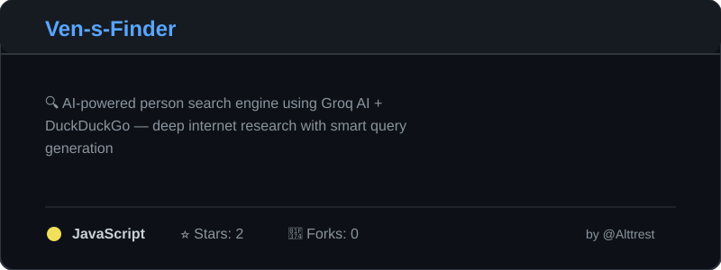

<p align="center">
  
</p>

# Ven-s-Finder

A local web application that combines Groq-generated search queries with DuckDuckGo results and a Turkish-language AI summary. It is intended for research across publicly available web sources.

## Search flow

1. The browser sends a name or topic, focus, and result limit to `POST /api/think`. Groq returns search queries.
2. `POST /api/search` runs those queries against DuckDuckGo, removes duplicate URLs, and returns up to the selected result limit.
3. `POST /api/analyze` sends the result snippets to Groq and returns a Turkish report.

The UI supports all, social media, news, academic, and business focus areas, with result limits of 5, 10, 20, or 50. Search results link to their source when a URL is available.

## Requirements

- Node.js 22 or later
- A Groq API key
- Network access to Groq and DuckDuckGo

## Setup

```sh
npm ci
cp .env.example .env
```

Set `GROQ_API_KEY` in `.env`, then start the server:

```sh
npm start
```

Open [http://localhost:3099](http://localhost:3099). To use another port, set `PORT` before starting the server. On PowerShell, copy the example file with `Copy-Item .env.example .env`.

Keep `.env` private. Do not commit API keys.

## HTTP API

| Endpoint | Request fields | Response |
| --- | --- | --- |
| `POST /api/think` | `query`, `focus`, `maxResults` | Search plan and query list |
| `POST /api/search` | `queries`, `maxResults` | Deduplicated web results |
| `POST /api/analyze` | `query`, `results`, `thinking`, `focus` | Turkish analysis report |

Supported focus values are `all`, `social`, `news`, `academic`, and `business`. The server rejects queries longer than 200 characters and applies an in-memory limit of 20 requests per IP per minute.

## Validation

GitHub Actions runs `npm ci` and checks the syntax of `server.js` and `public/app.js` on pushes and pull requests. The repository does not currently define automated unit tests or a lint script.

## Data handling

Search terms are sent to Groq to generate queries and write the report. Generated queries are sent to DuckDuckGo, and result titles, snippets, and URLs are sent to Groq for analysis. Verify claims against the linked sources; generated summaries can be inaccurate. Use the application only for lawful research using public information.
